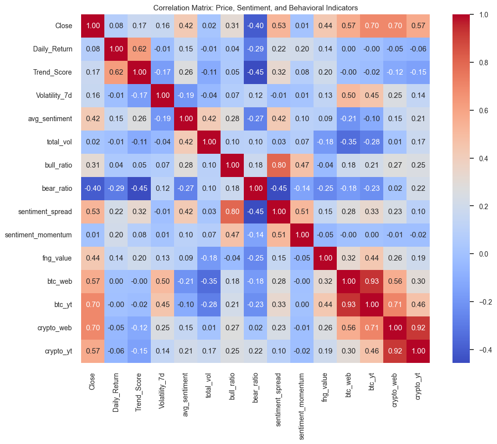
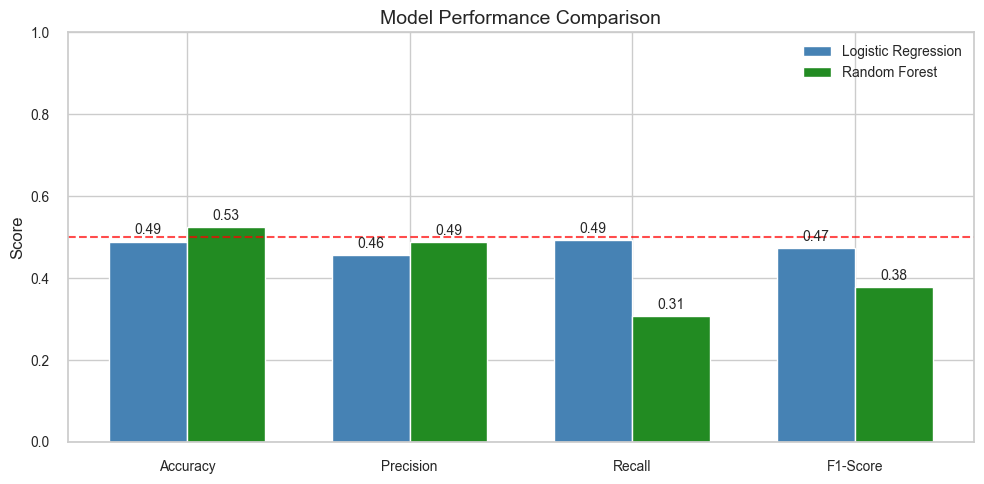

# 📊 **Understanding Bitcoin Price Movements Through Behavioral Data**

> **Key findings**
> - Integrated **4 data sources** (Yahoo Finance prices, millions of tweets, Google Trends, Crypto Fear & Greed Index) into a 2-year daily dataset (Feb 2021 – Jan 2023).
> - **No behavioral indicator** showed a statistically significant relationship with next-day returns (all Pearson p-values > 0.05).
> - Logistic Regression and Random Forest, trained on **94 engineered features**, reached **~49–53% accuracy**, close to random chance.
> - The results are consistent with the **Efficient Market Hypothesis**: public sentiment appears to be priced in already.

**Tech stack:** Python · pandas · NumPy · SciPy · scikit-learn · matplotlib · seaborn · VADER · yfinance

## 🧩 1. Project Overview

This project investigates whether **behavioral indicators** can help explain or anticipate **Bitcoin's short-term price movements**.  
Instead of focusing solely on financial metrics, the analysis incorporates external human-driven factors such as:

- Social media sentiment and activity  
- Public attention (Google Trends)  
- Investor psychology (Fear & Greed Index)  

The aim is to determine whether collective behavior — expressed online or through search activity — meaningfully relates to Bitcoin's daily price direction.

---

## 🗂️ 2. Data Overview & Collection Methods

The project uses four main datasets representing different behavioral and financial dimensions.

| Dataset | Description | Source | Collection Method |
|--------|-------------|--------|-------------------|
| **Bitcoin Price Data** | Open, high, low, close, volume values. | Yahoo Finance | Downloaded using the `yfinance` Python library. |
| **Bitcoin Tweets Data** | Millions of tweets containing the keyword "Bitcoin", used for sentiment and volume analysis. | Kaggle | Downloaded as CSV. Processed using chunk-based cleaning due to file size. |
| **Google Trends Data** | Daily search interest for "bitcoin" and "buy crypto" from Web Search & YouTube Search. | Google Trends | Exported as CSV via Google Trends interface. |
| **Crypto Fear & Greed Index** | Market psychology indicator (0 = extreme fear, 100 = extreme greed). | Yahoo Finance | Downloaded using the `yfinance` Python library. |

All datasets cover the period **February 2021 – January 2023**, using the **common overlapping time window** across all sources.

Note: The raw Bitcoin tweets dataset (~2GB+) is too large to include in this repository. Instead, the processed and aggregated version (processed_tweets_final.csv) is provided, which contains daily sentiment features extracted from millions of tweets. The original raw data can be downloaded from Kaggle.

---

## 🎯 3. Hypotheses
### 3.1 Research Question 
Can publicly available behavioral indicators (social media sentiment, attention metrics, and fear–greed measures) provide predictive power for Bitcoin’s next-day price direction?

### 3.2 Hypothesis
**Null Hypothesis (H₀):**  
Behavioral indicators (tweet sentiment, search interest, Fear & Greed Index) have **no significant effect** on Bitcoin's short-term price direction.

**Alternative Hypothesis (H₁):**  
Behavioral indicators have a **significant effect** on Bitcoin's short-term price direction.

---

## 💪 4. Motivation

I chose this topic because cryptocurrencies behave differently from traditional financial assets:

- Bitcoin's value is heavily influenced by **human behavior and emotion**, not intrinsic fundamentals.  
- As someone who followed crypto markets actively, I noticed that **social media narratives** strongly shape market mood.  
- My own negative investment experiences fueled curiosity about how much investors are influenced by **sentiment, hype, and online behavior**.  
- Bitcoin was selected because it is the **dominant cryptocurrency** and sets the tone for the entire crypto market.

This project aims to test whether these behavioral factors actually align with short-term market outcomes.

---

## ⚙️ 5. Data Preparation & Feature Engineering

### 5.1 Tweet Cleaning and Feature Engineering

The raw tweet dataset was extremely large, so a **chunk-based processing pipeline** was used with support from an AI assistant.

**Daily features created:**
- `total_vol` — daily tweet volume  
- `avg_sentiment` — weighted daily sentiment score (VADER)  
- `bull_ratio`, `bear_ratio` — ratio of bullish/bearish tweets  
- `sentiment_spread` — `bull_ratio - bear_ratio`  
- `sentiment_momentum` — day-to-day change in sentiment_spread  

### 5.2 Bitcoin Price Feature Engineering

- `Daily_Return` — daily percentage return  
- `Log_Return` — log-transformed return  
- `Volatility_7d` — 7-day rolling volatility  
- `Momentum_3d` — 3-day momentum indicator  
- `MA_7` — 7-day moving average  
- `Trend_Score` — simple trend indicator  
- `Target_Direction` — binary label (1 = up, 0 = down)

### 5.3 Google Trends Processing

Google Trends data was **interpolated to daily frequency** to align with other datasets, producing:
- `btc_web`, `btc_yt` (Bitcoin web and YouTube interest)  
- `crypto_web`, `crypto_yt` (general crypto interest)

---

## 📊 6. Exploratory Data Analysis (EDA)

Key findings from EDA:

- Tweet sentiment is **consistently positive**, reflecting an optimism bias in crypto discussions  
- Bullish signals frequently exceed bearish ones  
- Google Trends shows spikes around market events but does not track short-term returns  
- Fear & Greed Index moves between phases but shows **weak alignment with daily returns**  
- Correlation heatmap reveals **weak linear relationships** between behavioral and price features

<p align="center"></p>

---

## 🧪 7. Hypothesis Testing Results

### 7.1 Correlation Tests (Pearson)

| Test | r value | p-value | Result |
|------|---------|---------|--------|
| Sentiment vs Next Return | -0.053 | 0.657 | Fail to reject H₀ |
| Sentiment Spread vs Next Return | 0.070 | 0.555 | Fail to reject H₀ |
| Bull Ratio vs Next Return | -0.059 | 0.618 | Fail to reject H₀ |
| Bear Ratio vs Next Return | -0.167 | 0.159 | Fail to reject H₀ |
| Fear & Greed vs Next Return | 0.033 | 0.780 | Fail to reject H₀ |

**All p-values > 0.05** → No significant linear relationships found.

### 7.2 Mean Difference Tests (Up Days vs Down Days)

| Variable | Up Days Mean | Down Days Mean | t-test p | Mann-Whitney p | Result |
|----------|--------------|----------------|----------|----------------|--------|
| Avg Sentiment | 0.1885 | 0.1802 | 0.521 | 0.453 | Fail to reject H₀ |
| Sentiment Spread | 0.0885 | 0.0734 | 0.031 | 0.066 | Mixed (weak signal) |
| Bull Ratio | 0.1733 | 0.1668 | 0.299 | 0.530 | Fail to reject H₀ |
| Bear Ratio | 0.0848 | 0.0934 | 0.114 | 0.103 | Fail to reject H₀ |
| Fear & Greed | 43.34 | 36.81 | 0.195 | 0.122 | Fail to reject H₀ |

**Conclusion:** Behavioral indicators show **no consistent statistical difference** between up and down days.

---

## 🤖 8. Machine Learning Analysis

### 8.1 Feature Engineering for ML

To capture temporal dynamics, **94 features** were engineered:

| Feature Type | Count | Description |
|--------------|-------|-------------|
| **Lag Features** | 56 | Past values (1, 2, 3, 7 days) of key indicators |
| **Rolling Statistics** | 20 | 7-day and 14-day rolling mean/std |
| **Regime Features** | 1 | High/Low volatility regime indicator |
| **Interaction Features** | 2 | Sentiment × Volume, Trend × Volatility |

### 8.2 Models & Results

Two models were trained to predict **next-day price direction (Up/Down)**:

| Metric | Logistic Regression | Random Forest |
|--------|---------------------|---------------|
| **Accuracy** | 48.92% | 52.52% |
| **Precision** | 45.71% | 48.78% |
| **Recall** | 49.23% | 30.77% |
| **F1-Score** | 47.41% | 37.74% |

<p align="center"></p>

**Key Observations:**
- Both models performed near **random chance (~50%)**
- Random Forest showed conservative bias (predicts "Down" more often)
- No single feature provided strong predictive signal

### 8.3 Top Features (Random Forest Importance)

| Feature | Importance |
|---------|------------|
| fng_value_lag3 | 3.3% |
| Volatility_7d_lag7 | 2.5% |
| Trend_Score | 2.5% |
| Daily_Return_lag1 | 2.5% |
| Trend_Score_roll7_std | 2.4% |

Feature importance is **evenly distributed** — no dominant predictive feature exists.

---

## 📝 9. Final Conclusion

### Answer to Research Question

**Do behavioral indicators predict Bitcoin's short-term price direction?**

The evidence strongly suggests **no**.

- **Hypothesis testing:** All correlation tests failed to reject H₀ (p > 0.05)
- **Mean difference tests:** No significant differences between up/down days
- **Machine learning:** Both models achieved ~50% accuracy (random guessing level)

### Implications

- Supports the **Efficient Market Hypothesis** for cryptocurrency markets
- Publicly available sentiment data appears to be **already priced in**
- Short-term Bitcoin movements are **highly noisy and unpredictable**
- Sentiment-based trading strategies are **unlikely to succeed consistently**

### This is a Meaningful Negative Result

The finding that behavioral indicators lack predictive power is itself valuable — it warns against over-reliance on sentiment analysis for short-term crypto trading.

---

## ⚠️ 10. Limitations

**Data Limitations:**
- Tweet data may contain noise, bots, and spam despite cleaning
- Google Trends data required interpolation from weekly to daily
- Analysis period (2021-2023) may not generalize to other market conditions

**Methodological Limitations:**
- Only next-day prediction tested; longer horizons might differ
- Binary classification ignores magnitude of price movements
- Models were not extensively hyperparameter-tuned

**External Factors Not Modeled:**
- Macroeconomic events, regulatory announcements
- Whale movements and institutional trades
- Correlation with traditional markets

---

## 🔮 11. Future Work

- Test **longer prediction horizons** (3-day, 7-day, weekly returns)
- Include **on-chain data** (transaction volume, wallet activity)
- Apply **deep learning models** (LSTM, Transformer) for sequence modeling
- Analyze **event-specific windows** (sentiment impact during high-volatility periods)
- Extend to **other cryptocurrencies** (Ethereum, BNB, etc.)

---

## 📁 12. Project Structure

```
Crypto-Price-Prediction/
├── csv_files/
│   ├── bitcoin_adjusted.csv
│   ├── bitcoin_price.csv
│   ├── Bitcoin_web_trends.csv
│   ├── Bitcoin_yt_trends.csv
│   ├── Crypto_web_trends.csv
│   ├── Crypto_yt_trends.csv
│   ├── CryptoGreedFear.csv
│   ├── merged_data.csv
│   └── processed_tweets_final.csv
├── py_files/
│   ├── adjust_btc_price.py
│   ├── cleaning_tweets.py
│   ├── merging_and_testing_eda.py
│   ├── ml.py
│   └── testing_hyptests.py
├── images/
│   ├── correlation_matrix.png
│   └── model_comparison.png
├── main.ipynb
├── README.md
├── requirements.txt
└── termproject_summary.pdf
```

---

## 🛠️ 13. Installation & Usage

```bash
# Clone the repository
git clone https://github.com/mertkilic07/Crypto-Price-Prediction.git
cd Crypto-Price-Prediction

# Install dependencies
pip install -r requirements.txt

# Run the main notebook
jupyter notebook main.ipynb
```

---

## 🙏 14. Acknowledgments

- Tweet data processing (chunk-based cleaning) was developed with support from an AI assistant
- ML pipeline structure and feature engineering techniques were developed with guidance from an AI assistant

---

## ⏱️ 15. Project Timeline

| Date | Task |
|------|------|
| 31 October | Project proposal submitted |
| 30 November | Data collection, cleaning, EDA, hypothesis testing completed |
| 02 January | Machine learning analysis completed |
| 09 January | Final submission |
